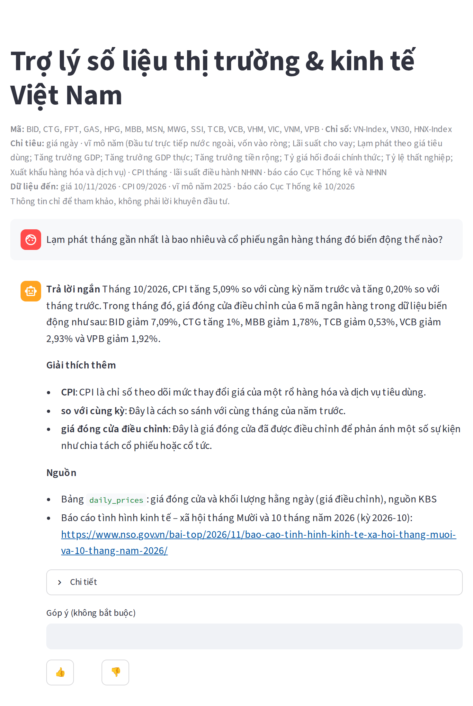
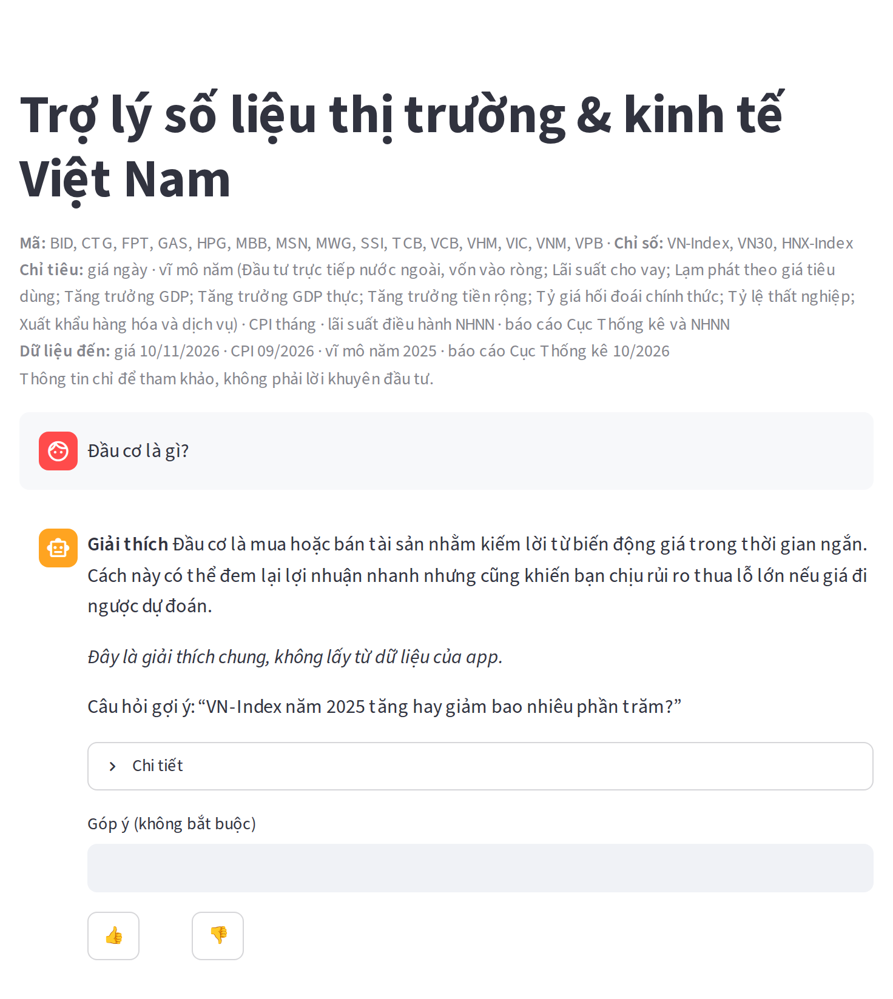
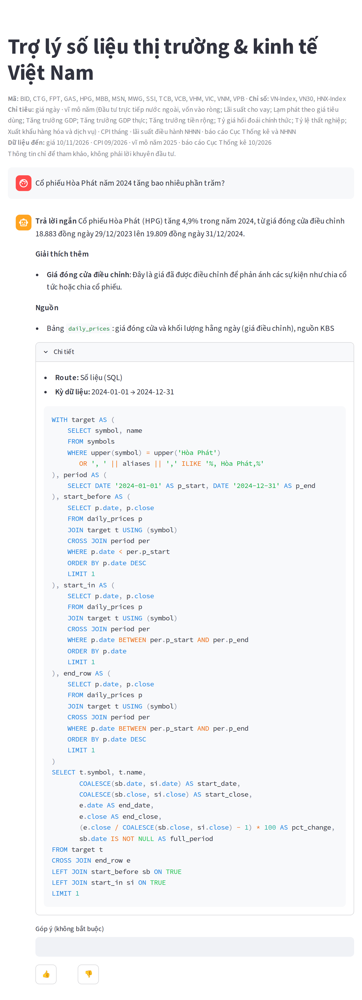
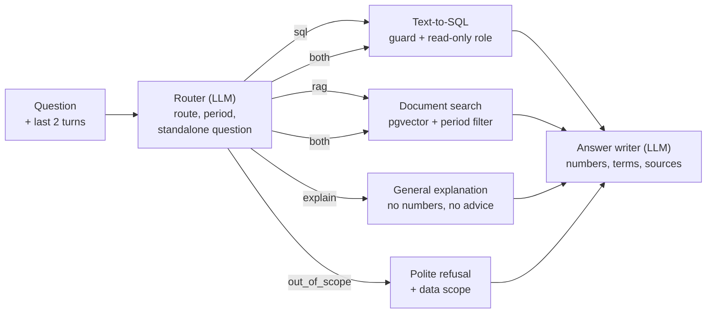

# vn-macro-assistant


A Vietnamese Q&A assistant about Vietnam's stock market and macroeconomy, made for
people new to investing. Ask in everyday Vietnamese ("Lạm phát tháng gần nhất là bao
nhiêu?", "Đầu cơ là gì?") and it answers with numbers from its own database or official
reports, explains the terms, and cites its sources. An agent routes each question to
Text-to-SQL, document search (RAG), both, or a short general explanation.

**Demo:** [vn-macro-assistant on Streamlit](https://vn-macro-assistant-fupbbsrhbjqfcefztyasqk.streamlit.app/)
(password protected, contact me for the password)

| Numbers + reports, with sources | General explanation |
|---|---|
|  |  |

| Numbers from SQL, with the generated query |
|---|
|  |

## Architecture



- **Router**: one LLM call picks the route and the time period ("năm ngoái", "tháng gần
  nhất" -> real dates). It also sees the **last 2 turns** of the session and rewrites a
  follow-up ("diễn biến như nào", "xếp hạng đi") into a standalone question that every
  later step uses.
- **Text-to-SQL**: schema context, SQL conventions and worked examples in the prompt; the
  query is checked, then run as a read-only role. One retry with the error message.
- **RAG**: 762 chunks from 17 official documents, filtered by the resolved period.
- **Answer writer**: short answer with the numbers, up to 3 terms explained for
  beginners, sources built by code (tables used, document titles and links). Refusals
  and missing data come with the list of data the app holds.
- Stack: Python 3.11, PostgreSQL + pgvector (16 locally in Docker, 18 on Neon for the
  deployed app), OpenAI API (`gpt-6-luna` for the router, Text-to-SQL and answers;
  `text-embedding-3-large` for embeddings), Streamlit, GitHub Actions (ruff + pytest).

## Data

The scope is deliberately narrow, so every answer can be checked.

| Data | Source | Range |
|---|---|---|
| Daily adjusted prices and volumes: **15 large stocks** (6 banks, VHM, VIC, HPG, FPT, VNM, MSN, MWG, GAS, SSI) and **3 indices** (VN-Index, VN30, HNX-Index) | KBS price API (unofficial), snapshot | 2015 (or listing date) to 2026-11-10 |
| **8 annual macro indicators**: GDP growth, inflation, lending rate, exchange rate, unemployment, FDI, exports, broad money | World Bank API | 2000-2025 (varies) |
| Real GDP growth with **IMF forecasts** | IMF WEO (October 2026) | 2000-2031 |
| Monthly CPI and year-over-year inflation | IMF CPI | 12/2001-09/2026 |
| SBV policy rate changes | Hand-checked from SBV announcements | 2020-2023 (all changes since 2020) |
| **17 documents**: NSO monthly socio-economic reports, SBV quarterly press conferences, the 2026 SBV directive | nso.gov.vn, SBV | 11/2025-10/2026 |

No company financials, news, gold, real estate or real-time prices. Details:
[docs/SCOPE.md](docs/SCOPE.md), [docs/data_sources.md](docs/data_sources.md).

## Safety

Text-to-SQL runs LLM-written SQL, so it is limited in layers:

1. **Query check** (`sqlglot`): one `SELECT` only; no writes, DDL, `SELECT ... INTO` or
   row locks; only schema `public`; blocked functions (file access, `pg_sleep`,
   `set_config`, advisory locks, ...); `LIMIT` forced to at most 200 rows.
2. **Execution**: `BEGIN READ ONLY`, `statement_timeout` 5 s, always rolled back.
3. **Database roles** (`sql/roles.sql`, checked by `python -m vnmacro.roles check`):

| Role | Can do | Used by |
|---|---|---|
| `vnmacro_reader` | `SELECT` on the data tables (`public`, `rag`); read-only by default, 5 s timeout, no access to the app log | Text-to-SQL, document search |
| `vnmacro_logger` | `INSERT` only on `app.query_log` and `app.feedback` | query and feedback logging |
| owner | schema changes and data loads | setup scripts only, never the app |

The log stores an anonymous random session id, never names or accounts.

## Offline evaluation

A test set of 40 questions written once and never used for tuning
([eval/results/summary.md](eval/results/summary.md)). One run per mode, each answer graded
by an LLM (correct / partial / wrong).

| | Correct | Partial | Wrong |
|---|---|---|---|
| **Agent**, original grades | 30 (75%) | 6 | 4 |
| **Agent**, 2 reference answers corrected | **32 (80%)** | 6 | 2 |
| RAG-only baseline (all questions to document search) | 14 (35%) | 7 | 19 |

- **Corrected references**: two reference answers were incomplete (VN30's 2021 high used
  the closing day, not the highest intraday high; 9-month credit growth listed only the
  SBV figure, not the NSO one). Only those two answers were graded again.
- **Router**: 37/40 correct routes.
- **Human check**: 10 random answers graded blind by me; agreement with the LLM grader
  **8/10**, both disagreements stricter on the LLM side.
- **Embeddings**: local `Vietnamese_Embedding_v2` vs OpenAI `text-embedding-3-large`
  (1024 dims) on the dev set: answer chunk in the top 5 for 6/6 questions with both.
  The app uses OpenAI to keep torch out of the deployment.
- **Cost and time**: agent $0.00065 and 10.4 s per question; RAG-only $0.0005 and 4.9 s.
  The whole graded run cost $0.058.

The `explain` route and follow-up questions were added **after** this run (from user
testing), so they are not in the test set; they were checked on the dev set only.

## User testing

A small test with about 8 people I know, to find real-world bugs, not to measure
satisfaction with statistical meaning. 66 questions over two days; every question,
route, answer and feedback is in [eval/user_testing/questions.csv](eval/user_testing/questions.csv)
(anonymous), the analysis in [eval/user_testing/summary.md](eval/user_testing/summary.md).

| | Round 1 (before `explain`) | Round 2 (after) |
|---|---|---|
| Questions | 23 | 43 |
| Routed `out_of_scope` | 52% | 23% |
| Declined or data missing | 57% | 47% |
| ... where the agent missed data or a better route | 2 | 10 |
| Thumbs up / down | 14 / 4 | 13 / 5 |

Bugs users found, all fixed:

- Beginner questions ("đầu cơ là gì") were refused -> new `explain` route.
- Follow-ups ("diễn biến như nào") were read alone and refused -> last 2 turns +
  standalone question.
- "Why did Vingroup rise" was refused -> answer with the move from the data and say
  reasons are not in it.
- A question with a data part and an opinion part got no data -> SQL for the part that
  can be answered.
- Concurrent users shared a log id; a thumbs click during an answer cancelled it.
- Long term lists and "market overview" answers that listed one day or every stock.

## Lessons learned

- **Routing decides most failures.** A strict "out of scope" made the app refuse
  reasonable questions; real users asked many "what is" and "why" questions that the
  test set did not have.
- **General rules beat special cases.** Fixes that held up were rules in the prompt
  ("answer the part the data can answer", "today means a calendar day"), not patches for
  one question.
- **Check the checker.** Two reference answers were wrong and the LLM grader was
  stricter than a human, so scores need a human look before they mean anything.
- **A handful of real users finds what an eval set cannot**: follow-ups, concurrency
  and UI bugs all showed up within two days.
- **Safety in layers is cheap**: a query check, a read-only transaction and a role that
  can only read cost little and do not depend on the LLM behaving.

## Limitations and next steps

- Narrow, static data: a snapshot up to 2026-11-10 from an unofficial price API;
  documents only for 11/2025-10/2026.
- Some data is only in quarterly reports (average wages), so a question without a
  period can miss it; subjective rankings ("most stable bank") are not answered.
- Test-set scores predate the later prompt changes; there is no multi-turn eval yet.
- Next: scheduled data refresh, more documents and years, a multi-turn eval set and a
  new test run, company names next to tickers in rankings, logging off the request path.

## Run locally

Needs Python 3.11+, Docker and an OpenAI API key. Full steps (data fetching, database
roles, embeddings): [docs/setup.md](docs/setup.md).

```bash
python -m venv .venv && source .venv/bin/activate
pip install -r requirements.txt -r requirements-dev.txt
cp .env.example .env            # fill in passwords, OPENAI_API_KEY, APP_PASSWORD
docker compose up -d            # PostgreSQL 16 + pgvector
# create tables and roles, fetch and load data, build the RAG index: docs/setup.md
streamlit run app.py
```

Tests: `ruff check . && ruff format --check . && pytest`
