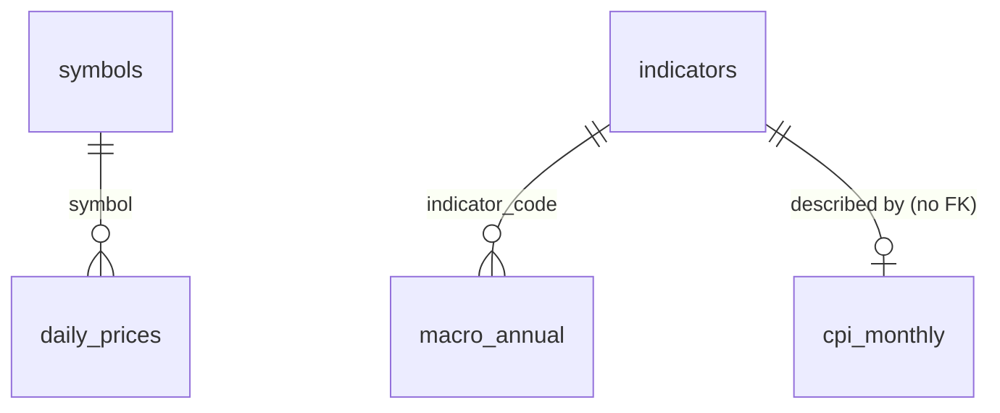
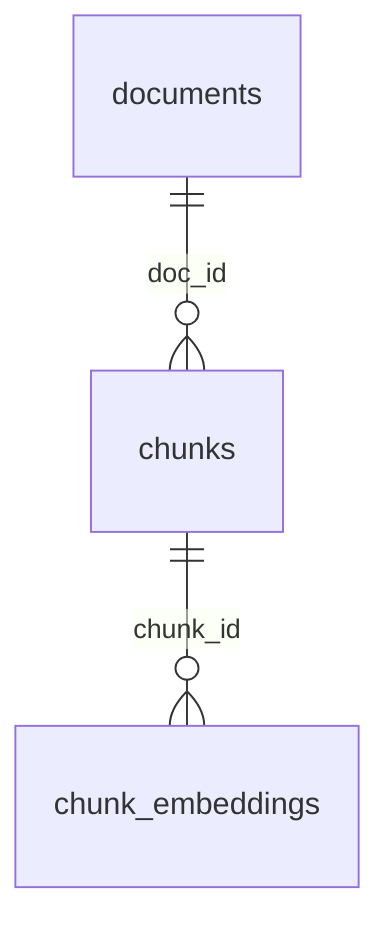

# Database Schema

Structured data layer for the Text-to-SQL tool (PostgreSQL 16). The DDL is in
`sql/schema.sql`. Every table and column there has a `COMMENT`, and those comments are what
the LLM sees when it writes SQL, so keep them in sync with this document.

Documents, chunks and embeddings for RAG live in a separate schema `rag`
(`sql/rag_schema.sql`); see [RAG schema](#rag-schema). The agent's query log lives in
schema `app` (`sql/app_schema.sql`); see [App schema and logger role](#app-schema-and-logger-role).

## Overview

| Table | Grain (one row per) | Primary key | Source |
|---|---|---|---|
| `symbols` | stock or index | `symbol` | hand-written from the scope |
| `daily_prices` | symbol x trading day | `(symbol, date)` | KBS snapshot |
| `indicators` | macro series | `indicator_code` | hand-written catalog |
| `macro_annual` | indicator x year | `(indicator_code, year)` | World Bank, IMF WEO |
| `cpi_monthly` | month | `month` | IMF CPI |
| `policy_events` | SBV decision x rate type | `(announced_date, rate_type)` | `data/manual/policy_events.csv` |

Relationships:

- `daily_prices.symbol` -> `symbols.symbol` (foreign key).
- `macro_annual.indicator_code` -> `indicators.indicator_code` (foreign key).
- `cpi_monthly` holds a single series. Its row in `indicators` (`table_name = 'cpi_monthly'`)
  describes it, but there is no foreign key column.
- `policy_events` stands alone. It is joined to `daily_prices` by date when a question asks
  about the market around an event (e.g. first trading day on or after `effective_date`).

## Tables

### symbols

| Column | Type | Null | Description |
|---|---|---|---|
| `symbol` | TEXT | no | Ticker or index code, upper case (`FPT`, `VNINDEX`). PK. |
| `name` | TEXT | no | Short Vietnamese name (`Vietcombank`, `VN-Index`). |
| `full_name` | TEXT | no | Full Vietnamese company or index name. |
| `aliases` | TEXT | no | Other names users may type, comma-separated: no diacritics, abbreviations. Default empty string. |
| `asset_type` | TEXT | no | `stock` or `index`. |
| `sector` | TEXT | yes | Vietnamese sector group (below). NULL for indices. |
| `exchange` | TEXT | no | `HOSE` or `HNX`. |
| `price_unit` | TEXT | no | `VND` for stocks, `points` for indices. |
| `first_date` | DATE | no | First date with a price in `daily_prices`. |

Sector values (the groups in `docs/SCOPE.md` section 2.1): `Ngân hàng`,
`Bất động sản / Đa ngành`, `Công nghiệp / Vật liệu`, `Công nghệ`, `Tiêu dùng / Bán lẻ`,
`Năng lượng`, `Chứng khoán`.

`aliases` is plain comma-separated text, not an array, so the LLM can search it with `ILIKE`
without `unnest`. Match a whole name, not a substring: `', ' || aliases || ',' ILIKE '%, mb,%'`.
A substring search (`ILIKE '%mb%'`) wrongly matches Vietcombank and Techcombank.

Checks: a stock has `price_unit = 'VND'` and a sector; an index has `price_unit = 'points'`
and no sector.

Expected rows: 15 stocks (all on HOSE) and 3 indices (`VNINDEX`, `VN30` on HOSE;
`HNXINDEX` on HNX).

### daily_prices

| Column | Type | Null | Description |
|---|---|---|---|
| `date` | DATE | no | Trading date (Vietnam time). |
| `symbol` | TEXT | no | FK to `symbols`. |
| `open` | NUMERIC(14,2) | no | Opening price. |
| `high` | NUMERIC(14,2) | no | Highest price. |
| `low` | NUMERIC(14,2) | no | Lowest price. |
| `close` | NUMERIC(14,2) | no | Closing price. |
| `volume` | BIGINT | yes | Matched volume in shares. |

- PK `(symbol, date)`; extra index on `date` for "all symbols on day X" queries.
- Units: stocks in **VND** (dong, not thousand dong; KBS already returns dong), indices in
  **points**. The unit is in `symbols.price_unit`, so one table holds both.
- Stock prices are **adjusted** for dividends and bonus shares (checked against CafeF,
  `docs/data_sources.md`); `volume` is the real, unadjusted volume. A price for a given
  day may differ from the board price, and adjusted levels can change in a new snapshot.
- `volume` is nullable because a known bad source value is set to NULL instead of being
  guessed (VNINDEX 2016-03-04, see `docs/data_sources.md`).
- Checks: all prices > 0, `low <= high`, `volume >= 0`.

### indicators

| Column | Type | Null | Description |
|---|---|---|---|
| `indicator_code` | TEXT | no | Source code of the series. PK. |
| `name` | TEXT | no | Vietnamese name. |
| `unit` | TEXT | no | Unit of the values. |
| `source` | TEXT | no | `World Bank`, `IMF WEO` or `IMF CPI`. |
| `frequency` | TEXT | no | `annual` or `monthly`. |
| `table_name` | TEXT | no | `macro_annual` or `cpi_monthly`. |
| `notes` | TEXT | yes | Caveats (lag, overlap with another series). |

Expected rows (10):

| indicator_code | source | table_name | unit |
|---|---|---|---|
| NY.GDP.MKTP.KD.ZG | World Bank | macro_annual | % |
| FP.CPI.TOTL.ZG | World Bank | macro_annual | % |
| FR.INR.LEND | World Bank | macro_annual | % |
| PA.NUS.FCRF | World Bank | macro_annual | VND/USD |
| SL.UEM.TOTL.ZS | World Bank | macro_annual | % labor force |
| BX.KLT.DINV.WD.GD.ZS | World Bank | macro_annual | % GDP |
| NE.EXP.GNFS.ZS | World Bank | macro_annual | % GDP |
| FM.LBL.BMNY.ZG | World Bank | macro_annual | % |
| NGDP_RPCH | IMF WEO | macro_annual | % |
| CPI | IMF CPI | cpi_monthly | index (2024 = 100) |

### macro_annual

| Column | Type | Null | Description |
|---|---|---|---|
| `indicator_code` | TEXT | no | FK to `indicators`. |
| `year` | INTEGER | no | Calendar year. |
| `value` | NUMERIC | no | Value in `indicators.unit`. |
| `is_forecast` | BOOLEAN | no | TRUE for IMF forecast years. Default FALSE. |
| `vintage` | TEXT | yes | WEO release, e.g. `WEO October 2026`. NULL for World Bank. |

- PK `(indicator_code, year)`. World Bank GDP growth (`NY.GDP.MKTP.KD.ZG`) and IMF GDP
  growth (`NGDP_RPCH`) have different codes, so both are kept side by side.
- Only one WEO vintage is stored at a time. Loading a new vintage replaces the old rows.
- `is_forecast = year > LATEST_ACTUAL_ANNUAL_DATA` of the vintage (`docs/data_sources.md`).
- Check: a forecast row must have a vintage.
- Missing years are not stored as rows (no NULL values), so `value` is NOT NULL.

### cpi_monthly

| Column | Type | Null | Description |
|---|---|---|---|
| `month` | DATE | no | First day of the month. PK. |
| `cpi_index` | NUMERIC | no | Headline CPI, 2024 = 100. |
| `inflation_yoy` | NUMERIC | yes | % change vs the same month of the previous year. |

- `month` is a DATE on day 1 (checked), so date functions and range filters work directly.
- `inflation_yoy` is computed once at load time (scope convention: inflation = y/y), so the
  LLM does not have to write a self-join. It is NULL for the first 12 months or when the
  month a year earlier is missing.
- Empty IMF rows are skipped at load time, not stored.

### policy_events

| Column | Type | Null | Description |
|---|---|---|---|
| `announced_date` | DATE | no | Decision signed / announced. |
| `effective_date` | DATE | no | New rate takes effect. |
| `rate_type` | TEXT | no | `refinancing` or `rediscount`. |
| `old_rate` | NUMERIC(5,2) | no | Rate before, % per year. |
| `new_rate` | NUMERIC(5,2) | no | Rate after, % per year. |
| `direction` | TEXT | no | `cut` or `hike`. |
| `document_no` | TEXT | yes | SBV decision number, e.g. `1123/QĐ-NHNN`. |
| `source_url` | TEXT | yes | Source used to record the row. |
| `notes` | TEXT | yes | Source caveats and other rates changed by the same decision. |

- PK `(announced_date, rate_type)`: one decision changes each rate type at most once.
- One decision can produce two rows, so "how many decisions" needs
  `COUNT(DISTINCT announced_date)`. The table comment says this for the LLM.
- Only CSV rows with `verified = yes` are loaded, so the `verified` column is dropped.
- Checks: `effective_date >= announced_date`; `direction` agrees with the sign of
  `new_rate - old_rate`.

## RAG schema

DDL: `sql/rag_schema.sql`. It creates schema `rag`, the `vector` extension (installed in
`rag`) and three tables. Tables are created empty; loading comes in a later step.

| Table | Grain (one row per) | Primary key | Source |
|---|---|---|---|
| `rag.documents` | source document | `doc_id` | `data/manual/documents.csv` (verified rows) |
| `rag.chunks` | chunk x strategy | `chunk_id` (unique `(doc_id, strategy, seq)`) | `chunks.jsonl` |
| `rag.chunk_embeddings` | chunk x embedding model | `(chunk_id, model_name)` | embedding step |

- `rag.documents.period_start` / `period_end` are derived from `reference_period` at load
  time: `YYYY-MM` = the whole month, `YYYY-Qn` = the whole quarter, `YYYY` = the whole year.
  A CHECK enforces the `reference_period` format and `period_start <= period_end`.
- `rag.chunks.strategy` (e.g. `heading_v1`) lets several chunking strategies coexist.
- `rag.chunk_embeddings.embedding` is `vector(1024)`; the PK includes `model_name`, so
  vectors from several models can be stored and compared.
- Foreign keys use `ON DELETE CASCADE`: deleting a document removes its chunks and their
  embeddings.

Design reasons:

1. **Separate schema `rag`.** The Text-to-SQL tool reads only schema `public`, so it sees
   just the numeric tables and never writes SQL against document text or vectors. The two
   parts can also be dropped and recreated independently. The `vector` extension is
   installed in `rag` (not `public`) so that `DROP SCHEMA public CASCADE` cannot drop the
   vector type. Vector queries therefore need `rag` on the `search_path` (or
   `OPERATOR(rag.<=>)`).
2. **No vector index yet.** With a few hundred chunks, an exact full scan is fast and gives
   exact nearest neighbours. An approximate index (HNSW / IVFFlat) is worth adding only when
   chunks reach tens of thousands.

## Read-only role for Text-to-SQL

The Text-to-SQL agent connects as `vnmacro_reader` (`sql/roles.sql`, applied with
`python -m vnmacro.roles apply`; `check` tests the rules below).

- **Can:** connect to the database and `SELECT` from every table in schemas `public` and
  `rag`, including tables the owner creates later (default privileges).
- **Cannot:** read schema `app`; `INSERT`, `UPDATE`, `DELETE` or `TRUNCATE`; create
  objects in any schema; create temporary tables (`TEMP` is revoked from `PUBLIC`).
- **Session settings:** `default_transaction_read_only = on`, `statement_timeout = 5s`,
  `search_path = public`.

Why: two independent layers. The code checks every generated SQL statement before running
it (Phase 3), and the database refuses anything but reads even if a bad statement gets
past that check. Reading `rag` is allowed because it holds only public documents (the
router reads `rag.documents` for the newest report); the SQL check still limits
LLM-written SQL to the tables in `public`. The privileges are the hard limit; read-only mode and the timeout are
session defaults the role could change itself, so they add depth but do not replace the
privileges. The timeout also stops runaway queries.

The same file also runs on Neon (`python -m vnmacro.roles apply|check --target neon`),
where the owner is not a superuser: the `NOSUPERUSER` attribute is only set when the
owner is a superuser (PostgreSQL 16+ forbids naming it otherwise; a role created by a
non-superuser can never be one), and passwords are sent as plain text over TLS because
Neon rejects pre-hashed passwords.

The load (`load_db`) empties and refills tables with `TRUNCATE` + `COPY`, so the grants
survive every load. `DROP SCHEMA public CASCADE` removes them: rerun `apply` afterwards.

## App schema and logger role

DDL: `sql/app_schema.sql` (safe to rerun: `CREATE ... IF NOT EXISTS` and guarded constraint
changes only, never deletes log rows; a column change needs an explicit `ALTER TABLE`).
Privileges: `sql/roles.sql`.

| Table | Grain (one row per) | Primary key | Written by |
|---|---|---|---|
| `app.query_log` | request to an agent component (all its LLM attempts) | `id` (identity) | `vnmacro_logger` |
| `app.feedback` | thumbs up/down given in the app | `id` (identity) | `vnmacro_logger` |

Columns: `run_id` (uuid, unique; see below), `request_id` (uuid shared by all step rows of
one agent question; NULL when a component runs alone), `created_at`, `component`
(`router`, `retrieve`, `text_to_sql` or `answer`), `question`, `model`,
`prompt_version` (short hash of schema context + conventions + examples), `status`
(`ok`, `cannot_answer`, `blocked`, `error`), `final_sql`, `attempts` (LLM calls),
`sql_attempts` (JSON array: each SQL tried and its error), `error`, `row_count`,
`latency_ms`, `input_tokens`, `cached_input_tokens`, `output_tokens`, `cost_usd`,
`session_id` (anonymous app session: random uuid4 made when the app is opened and kept
only in the Streamlit session; no user data; NULL outside the app), `answer_text` (final
Markdown answer shown to the user, answer rows only).
CHECKs: a `text_to_sql` row with `ok` needs `final_sql` (router rows have no SQL; their
decision is the single object in `sql_attempts`), `error` needs `error`, cached tokens <= input tokens,
counts >= 0, `sql_attempts` is an array.

`app.feedback` columns: `request_id` (uuid of the answered question, joins `app.query_log`;
no foreign key because `request_id` is not unique there), `rating` (`up` / `down`),
`comment` (optional, at most 1000 characters), `created_at`, `session_id` (same anonymous
app session as in the log). `vnmacro_logger` may only
insert into it, like the log.

The agent writes the log as `vnmacro_logger`:

- **Can:** connect; `USAGE` on schema `app`; `INSERT` into `app.query_log`; draw ids from
  its sequence.
- **Cannot:** read `app.query_log` (so `INSERT ... RETURNING` is not allowed either);
  read or write anything in `public` or `rag`; create objects or temporary tables.
- **Session settings:** `statement_timeout = 5s`, `search_path = app`.

Why:

1. **Separate schema `app`.** `DROP SCHEMA public CASCADE` (recreating the numeric tables)
   leaves the log intact, and the Text-to-SQL schema context, built from schema `public`
   only, never shows it. `vnmacro_reader` has no access to `app`.
2. **Insert-only role.** Questions may hold personal data. A leaked or misused app
   credential can add rows but cannot read other users' questions or touch the data.
   Only the owner reads the log (evaluation, cost tracking).
3. **One row per request, attempts in JSON.** Retries stay with their request, and the
   token and cost totals sum without joins. `prompt_version` ties each row to the exact
   prompt prefix, so results can be compared across prompt changes.
4. **`run_id` made by the code.** The logger cannot use `INSERT ... RETURNING id`, so
   the Python code creates a uuid4 before the INSERT and keeps it. User feedback
   (thumbs up/down, Phase 7) will refer to this `run_id`; `id` stays an internal key.

Limit: PostgreSQL catalogs are readable by every role, so `vnmacro_reader` can still see
that `app.query_log` exists (name and columns), but not its rows.

## Design choices

- **Few, narrow tables.** A small schema with clear names is easier for Text-to-SQL than a
  normalized warehouse. Each table has one grain, stated in its comment.
- **Comments are the LLM's data dictionary.** Units, value lists and pitfalls (adjusted
  prices, forecasts, distinct decisions) live in `COMMENT ON` so they travel with the schema.
- **Units in data, not in column names.** `symbols.price_unit` and `indicators.unit` carry
  units; this avoids separate tables for stocks and indices.
- **CHECK constraints for value lists** instead of lookup tables: the lists are short and
  stable, and the allowed values show up in the DDL the LLM reads.
- **No source column on value tables.** The source follows from the indicator
  (`indicators.source`) or the table (`daily_prices` = KBS, `cpi_monthly` = IMF CPI).
- **Raw data stays in files.** Fixes from `docs/data_sources.md` (dropped rows, NULL volume)
  are applied at load time; the database holds only the cleaned result.

## Ideas for later phases

- Phase 3 idea: symbols has only 18 rows, so include the whole table in the LLM prompt for
  name-to-symbol mapping instead of fuzzy SQL search.
- Store unadjusted (board) prices alongside adjusted prices, from a corporate-actions or
  raw-price source.
- Optional, not part of Phase 6: try balanced splitting (split a long section into roughly
  equal parts) as a new chunking strategy (see SCOPE.md, "Future work").
