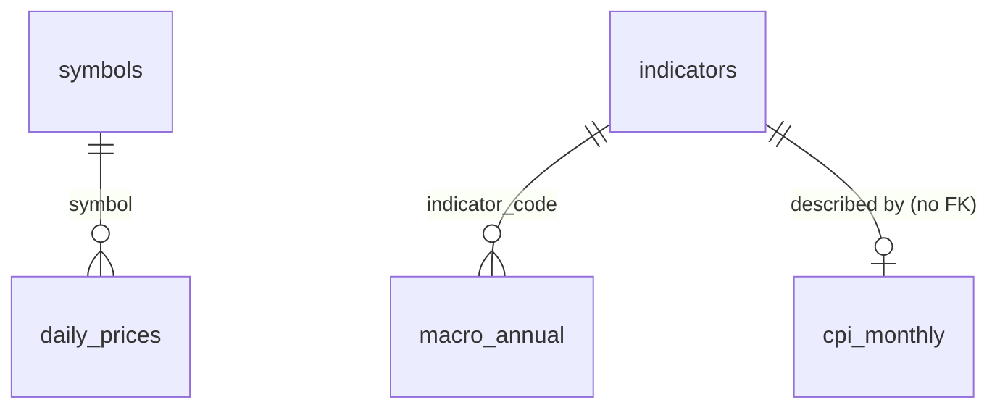

# Database Schema

Structured data layer for the Text-to-SQL tool (PostgreSQL 16). The DDL is in
`sql/schema.sql`. Every table and column there has a `COMMENT`, and those comments are what
the LLM sees when it writes SQL, so keep them in sync with this document.

Documents and embeddings for RAG (pgvector) are not part of this schema yet.

## Overview

| Table | Grain (one row per) | Primary key | Source |
|---|---|---|---|
| `symbols` | stock or index | `symbol` | hand-written from the scope |
| `daily_prices` | symbol x trading day | `(symbol, date)` | KBS snapshot |
| `indicators` | macro series | `indicator_code` | hand-written catalog |
| `macro_annual` | indicator x year | `(indicator_code, year)` | World Bank, IMF WEO |
| `cpi_monthly` | month | `month` | IMF CPI |
| `policy_events` | SBV decision x rate type | `(announced_date, rate_type)` | `data/manual/policy_events.csv` |

Relationships:

- `daily_prices.symbol` -> `symbols.symbol` (foreign key).
- `macro_annual.indicator_code` -> `indicators.indicator_code` (foreign key).
- `cpi_monthly` holds a single series. Its row in `indicators` (`table_name = 'cpi_monthly'`)
  describes it, but there is no foreign key column.
- `policy_events` stands alone. It is joined to `daily_prices` by date when a question asks
  about the market around an event (e.g. first trading day on or after `effective_date`).

## Tables

### symbols

| Column | Type | Null | Description |
|---|---|---|---|
| `symbol` | TEXT | no | Ticker or index code, upper case (`FPT`, `VNINDEX`). PK. |
| `name` | TEXT | no | Short Vietnamese name (`Vietcombank`, `VN-Index`). |
| `full_name` | TEXT | no | Full Vietnamese company or index name. |
| `aliases` | TEXT | no | Other names users may type, comma-separated: no diacritics, abbreviations. Default empty string. |
| `asset_type` | TEXT | no | `stock` or `index`. |
| `sector` | TEXT | yes | Vietnamese sector group (below). NULL for indices. |
| `exchange` | TEXT | no | `HOSE` or `HNX`. |
| `price_unit` | TEXT | no | `VND` for stocks, `points` for indices. |
| `first_date` | DATE | no | First date with a price in `daily_prices`. |

Sector values (the groups in `docs/SCOPE.md` section 2.1): `Ngân hàng`,
`Bất động sản / Đa ngành`, `Công nghiệp / Vật liệu`, `Công nghệ`, `Tiêu dùng / Bán lẻ`,
`Năng lượng`, `Chứng khoán`.

`aliases` is plain comma-separated text, not an array, so the LLM can search it with a simple
`ILIKE '%...%'` (together with `name` and `full_name`) without `unnest`.

Checks: a stock has `price_unit = 'VND'` and a sector; an index has `price_unit = 'points'`
and no sector.

Expected rows: 15 stocks (all on HOSE) and 3 indices (`VNINDEX`, `VN30` on HOSE;
`HNXINDEX` on HNX).

### daily_prices

| Column | Type | Null | Description |
|---|---|---|---|
| `date` | DATE | no | Trading date (Vietnam time). |
| `symbol` | TEXT | no | FK to `symbols`. |
| `open` | NUMERIC(14,2) | no | Opening price. |
| `high` | NUMERIC(14,2) | no | Highest price. |
| `low` | NUMERIC(14,2) | no | Lowest price. |
| `close` | NUMERIC(14,2) | no | Closing price. |
| `volume` | BIGINT | yes | Matched volume in shares. |

- PK `(symbol, date)`; extra index on `date` for "all symbols on day X" queries.
- Units: stocks in **VND** (dong, not thousand dong; KBS already returns dong), indices in
  **points**. The unit is in `symbols.price_unit`, so one table holds both.
- Stock prices are adjusted as returned by KBS (see open issue in `docs/data_sources.md`).
- `volume` is nullable because a known bad source value is set to NULL instead of being
  guessed (VNINDEX 2016-03-04, see `docs/data_sources.md`).
- Checks: all prices > 0, `low <= high`, `volume >= 0`.

### indicators

| Column | Type | Null | Description |
|---|---|---|---|
| `indicator_code` | TEXT | no | Source code of the series. PK. |
| `name` | TEXT | no | Vietnamese name. |
| `unit` | TEXT | no | Unit of the values. |
| `source` | TEXT | no | `World Bank`, `IMF WEO` or `IMF CPI`. |
| `frequency` | TEXT | no | `annual` or `monthly`. |
| `table_name` | TEXT | no | `macro_annual` or `cpi_monthly`. |
| `notes` | TEXT | yes | Caveats (lag, overlap with another series). |

Expected rows (10):

| indicator_code | source | table_name | unit |
|---|---|---|---|
| NY.GDP.MKTP.KD.ZG | World Bank | macro_annual | % |
| FP.CPI.TOTL.ZG | World Bank | macro_annual | % |
| FR.INR.LEND | World Bank | macro_annual | % |
| PA.NUS.FCRF | World Bank | macro_annual | VND/USD |
| SL.UEM.TOTL.ZS | World Bank | macro_annual | % labor force |
| BX.KLT.DINV.WD.GD.ZS | World Bank | macro_annual | % GDP |
| NE.EXP.GNFS.ZS | World Bank | macro_annual | % GDP |
| FM.LBL.BMNY.ZG | World Bank | macro_annual | % |
| NGDP_RPCH | IMF WEO | macro_annual | % |
| CPI | IMF CPI | cpi_monthly | index (2024 = 100) |

### macro_annual

| Column | Type | Null | Description |
|---|---|---|---|
| `indicator_code` | TEXT | no | FK to `indicators`. |
| `year` | INTEGER | no | Calendar year. |
| `value` | NUMERIC | no | Value in `indicators.unit`. |
| `is_forecast` | BOOLEAN | no | TRUE for IMF forecast years. Default FALSE. |
| `vintage` | TEXT | yes | WEO release, e.g. `WEO October 2026`. NULL for World Bank. |

- PK `(indicator_code, year)`. World Bank GDP growth (`NY.GDP.MKTP.KD.ZG`) and IMF GDP
  growth (`NGDP_RPCH`) have different codes, so both are kept side by side.
- Only one WEO vintage is stored at a time. Loading a new vintage replaces the old rows.
- `is_forecast = year > LATEST_ACTUAL_ANNUAL_DATA` of the vintage (`docs/data_sources.md`).
- Check: a forecast row must have a vintage.
- Missing years are not stored as rows (no NULL values), so `value` is NOT NULL.

### cpi_monthly

| Column | Type | Null | Description |
|---|---|---|---|
| `month` | DATE | no | First day of the month. PK. |
| `cpi_index` | NUMERIC | no | Headline CPI, 2024 = 100. |
| `inflation_yoy` | NUMERIC | yes | % change vs the same month of the previous year. |

- `month` is a DATE on day 1 (checked), so date functions and range filters work directly.
- `inflation_yoy` is computed once at load time (scope convention: inflation = y/y), so the
  LLM does not have to write a self-join. It is NULL for the first 12 months or when the
  month a year earlier is missing.
- Empty IMF rows are skipped at load time, not stored.

### policy_events

| Column | Type | Null | Description |
|---|---|---|---|
| `announced_date` | DATE | no | Decision signed / announced. |
| `effective_date` | DATE | no | New rate takes effect. |
| `rate_type` | TEXT | no | `refinancing` or `rediscount`. |
| `old_rate` | NUMERIC(5,2) | no | Rate before, % per year. |
| `new_rate` | NUMERIC(5,2) | no | Rate after, % per year. |
| `direction` | TEXT | no | `cut` or `hike`. |
| `document_no` | TEXT | yes | SBV decision number, e.g. `1123/QĐ-NHNN`. |
| `source_url` | TEXT | yes | Source used to record the row. |
| `notes` | TEXT | yes | Source caveats and other rates changed by the same decision. |

- PK `(announced_date, rate_type)`: one decision changes each rate type at most once.
- One decision can produce two rows, so "how many decisions" needs
  `COUNT(DISTINCT announced_date)`. The table comment says this for the LLM.
- Only CSV rows with `verified = yes` are loaded, so the `verified` column is dropped.
- Checks: `effective_date >= announced_date`; `direction` agrees with the sign of
  `new_rate - old_rate`.

## Design choices

- **Few, narrow tables.** A small schema with clear names is easier for Text-to-SQL than a
  normalized warehouse. Each table has one grain, stated in its comment.
- **Comments are the LLM's data dictionary.** Units, value lists and pitfalls (adjusted
  prices, forecasts, distinct decisions) live in `COMMENT ON` so they travel with the schema.
- **Units in data, not in column names.** `symbols.price_unit` and `indicators.unit` carry
  units; this avoids separate tables for stocks and indices.
- **CHECK constraints for value lists** instead of lookup tables: the lists are short and
  stable, and the allowed values show up in the DDL the LLM reads.
- **No source column on value tables.** The source follows from the indicator
  (`indicators.source`) or the table (`daily_prices` = KBS, `cpi_monthly` = IMF CPI).
- **Raw data stays in files.** Fixes from `docs/data_sources.md` (dropped rows, NULL volume)
  are applied at load time; the database holds only the cleaned result.
