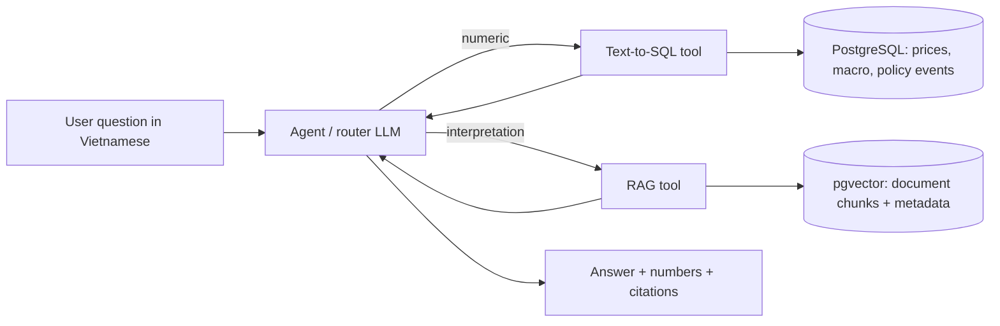

# Project Scope: Vietnam Market & Macro Assistant

## 1. Goal

A question-answering assistant for Vietnamese users. The user asks in Vietnamese; an agent decides
whether to query structured data (Text-to-SQL) or read official documents (RAG), or both, and
answers with numbers and citations.

Target users: beginner retail investors and people new to the Vietnamese market and economy.
They ask in plain Vietnamese, may not know financial terms, and need answers that are accurate,
sourced, and easy to understand. The assistant explains data and official reports; it does not
give investment advice.

Portfolio value: Vietnamese data, a real-world setting, a measurable evaluation set, controlled
comparisons between versions, and a deployed demo.

## 2. In scope

### 2.1 Structured data (PostgreSQL) - for numeric questions

| Dataset | Source | Frequency | Range |
|---|---|---|---|
| Index prices: VN-Index, VN30, HNX-Index | KBS API (unofficial), snapshot | Daily OHLCV | 2015-01-01 to present |
| 15 large-cap stocks (list below) | KBS API (unofficial), snapshot | Daily OHLCV | 2017-01-01 to present |
| Macro indicators (list below) | World Bank API | Annual | 2000 to latest |
| Real GDP growth (NGDP_RPCH): actuals + IMF forecasts. First version: GDP growth only; other WEO indicators are left for a later version | IMF Data Portal (WEO), vintage stored (e.g. "WEO October 2026") | Annual | 2000 to latest actual year, plus forecast years (2026-2031 in WEO October 2026) |
| Monthly CPI | IMF Data Portal (CPI dataset), headline CPI only | Monthly | 2001-12 to latest available (09/2026 at smoke test) |
| SBV policy rate changes | Hand-curated from sbv.gov.vn | Event-based | 2020 to present |

Tickers (15, across sectors):

- Banks: VCB, BID, CTG, TCB, MBB, VPB
- Real estate / conglomerate: VHM, VIC
- Industrials / materials: HPG
- Technology: FPT
- Consumer / retail: VNM, MSN, MWG
- Energy: GAS
- Securities: SSI

World Bank indicators (codes to be verified in smoke test):

| Indicator | Code |
|---|---|
| GDP growth (annual %) | NY.GDP.MKTP.KD.ZG |
| Inflation, consumer prices (annual %) | FP.CPI.TOTL.ZG |
| Lending interest rate (%) | FR.INR.LEND |
| Official exchange rate (VND per USD, period average) | PA.NUS.FCRF |
| Unemployment (% of labor force) | SL.UEM.TOTL.ZS |
| FDI, net inflows (% of GDP) | BX.KLT.DINV.WD.GD.ZS |
| Exports of goods and services (% of GDP) | NE.EXP.GNFS.ZS |
| Broad money growth (annual %) | FM.LBL.BMNY.ZG |

### 2.2 Documents (vector store) - for interpretation and policy questions

The document list is kept in `data/manual/documents.csv` (one row per document, with URL,
publication date and a `verified` flag).

First version (MVP):

| Document type | Source | Reference periods | Count |
|---|---|---|---|
| Monthly socio-economic reports (the report for the last month of a quarter is the quarterly report) | National Statistics Office (nso.gov.vn) | 2025-11 to 2026-10 | 12 |
| Directive 01/CT-NHNN (2026) on monetary policy and banking tasks for the year | State Bank of Vietnam (news summary via thitruongtaichinhtiente.vn) | 2026 | 1 |
| Quarterly press releases / press conferences on banking results | State Bank of Vietnam (via vnba.org.vn) | 2025-Q4, 2026-Q1, 2026-Q2, 2026-Q3 | 4 |

Selection rules:

- Prefer the official page on nso.gov.vn or sbv.gov.vn. If a document cannot be found or the
  site blocks access, it still gets a row, with an empty URL and the reason in `notes`.
- SBV documents are taken from their republication on vnba.org.vn (Vietnam Banks
  Association), because sbv.gov.vn blocks automated access and is often unavailable. Each
  republication is checked in a browser against the original press conference.
- No separate NSO CPI press releases: the monthly report already has a prices section with
  the CPI figures and the reasons for the change.
- NSO reports are ingested from the attached full-text .docx (link in `notes`), not from the
  web page: the page is a shortened version and can miss details such as the reasons for a
  CPI change.
- Directive 01/CT-NHNN is covered by a news summary (not the full text); this is accepted
  for the first version.

Optional later update: extend the range back to 2022-01, so policy questions can cover the
2022 tightening cycle and the 2023 easing cycle. This includes the SBV press releases on the
policy rate changes of 2022-2023, added together with downloading documents back to 2022.
This is **optional** and is done only after deployment (Phase 7), as an update release; the
first version is built, evaluated and deployed with the MVP documents above.

### 2.3 Question types

1. Numeric (SQL): prices, returns, volumes, macro values, comparisons across periods or tickers.
2. Interpretation (RAG): what a report or press release says, reasons, assessments, policy direction.
3. Hybrid (SQL + RAG): a number plus its explanation, or market behavior around a policy event.
4. Out of scope: the assistant must decline clearly instead of guessing.

## 3. Out of scope

- Investment advice, buy/sell recommendations, price predictions made by the assistant itself
- Intraday or real-time prices
- Company financial statements (revenue, profit, ratios)
- News articles and social media
- Gold prices, crypto, commodities, real estate prices
- English-language questions (Vietnamese only for v1)
- Model fine-tuning

## 4. Conventions (to keep answers and the evaluation set consistent)

- "Latest month" / "tháng gần nhất" = the most recent report available in the database, not today's date.
- Returns are close-to-close, in percent, using the last trading day of each period.
- Returns use adjusted prices when the source provides them. If only unadjusted prices
  are available, the answer states this limitation (returns across dividends, bonus
  shares or splits may be distorted).
- Prices are adjusted for dividends and bonus shares. Percentage changes use adjusted
  prices. Volume is the real traded volume (not adjusted).
- When answering the price of a specific day, the assistant must say it is an adjusted
  price and may differ from the price shown on the trading board that day.
- Adjusted prices can change when a new snapshot includes new corporate actions;
  reference answers that use price levels are tied to the snapshot date.
- "N months after event X" starts from the first trading day on or after the event date.
- Every numeric answer states its source and date range; every document-based answer cites
  the document title and publication date.
- If data is missing, the assistant says so and does not estimate.
- Inflation = year-over-year % change of the CPI index (same month of the previous year).
- Numeric CPI/inflation answers must state the source ("according to IMF").
- If the asked month is not yet in the IMF data, answer from the NSO monthly report (RAG)
  and say so.
- If IMF and NSO figures differ, show both and name each source.
- Forecast values are stored with is_forecast = true and the WEO vintage.
- Any answer using a forecast must say it is an IMF forecast and name the WEO vintage.
  The assistant never makes its own forecasts.
- Default source when the user does not name one (always state the source in the answer):
  - Past years (annual macro): World Bank.
  - Future years: IMF WEO, always called a forecast with its vintage.
  - Monthly inflation: IMF CPI.
- If the user names a source, use exactly that source.

## 5. Architecture

Design choice: one PostgreSQL instance with the pgvector extension holds both tables and
embeddings, so deployment needs a single database container.

## 6. Tech stack (initial choices, may change after experiments)

| Layer | Choice |
|---|---|
| Language | Python 3.11+ |
| Database | PostgreSQL 16 + pgvector (Docker) |
| Market data | KBS API (unofficial; fallback: Vietcap), snapshot in `data/raw/` |
| IMF data | IMF Data Portal SDMX 3.0 API (e.g. via the imfp package) |
| Agent | Plain LLM tool calling first; LangGraph only if needed |
| Embeddings | `AITeamVN/Vietnamese_Embedding_v2` (open, pinned commit, CPU) vs one API embedding model from the LLM provider (1024 dims) |
| LLMs | One API model, chosen in Phase 3 (no LLM comparison in the first version) |
| UI | Streamlit |
| Packaging | Docker Compose |

## 7. Evaluation plan (summary)

- About 100 questions with reference answers, grown from the seed questions in
  `eval/seed_questions.csv`.
- Target mix: ~40 numeric, ~40 interpretation, ~10 hybrid, ~10 out-of-scope.
- Metrics: routing accuracy, SQL execution accuracy, retrieval recall@k, answer faithfulness,
  refusal accuracy, latency, cost per question.
- Planned comparisons (Phase 6), only these two:
  1. **RAG-only vs agent (RAG + Text-to-SQL)** on the same eval set.
  2. **Embedding models:** `AITeamVN/Vietnamese_Embedding_v2` vs one API embedding model
     from the same provider as the LLM chosen in Phase 3, with the API output set to
     1024 dimensions (same vector column). Measures: retrieval hit@5, latency, cost per
     query, deployment footprint (model size, RAM, extra services).
- Scoring the first version: q11, q15 and q17 are marked "not applicable (requires 2022+
  documents)" and are not counted in any score. They become scored questions only if the
  optional 2022+ document update (section 2.2) is done.

### Future work / not in first version

- Chunking strategies, including balanced splitting (split a long section into roughly
  equal parts) as an alternative to `heading_v1`.
- LLM comparison (e.g. a strong model vs a smaller, cheaper one).
- Other open embedding models: BGE-M3, Qwen3-Embedding.
- A reranker on top of vector search.
- Documents back to 2022 (optional update after Phase 7, section 2.2).

## 8. Data notes and risks

- Monthly macro series for Vietnam are limited in public APIs (mostly annual or quarterly).
  The monthly reports in the RAG layer fill this gap.
- The legacy IMF API (dataservices.imf.org) has been retired. Use the new IMF Data Portal API only.
- IMF CPI lags NSO by about one month and may differ slightly from NSO published figures.
- vnstock (and its dependency vnai) is quarantined on PyPI pending a security review, so it
  is not used. Prices are fetched directly from the KBS API (fallback: Vietcap).
- The KBS and Vietcap APIs are not public: undocumented, may change without notice, and their
  terms of use are unclear. Use them for learning purposes only, never commit raw downloaded
  data to the repository (commit the scripts that fetch it), and reduce the risk by fetching
  once into a dated snapshot in `data/raw/`. The app reads only from the snapshot / PostgreSQL
  and never calls these APIs at runtime. See `docs/data_sources.md`.
- Stock prices start on 2017-01-01 (index prices still start on 2015-01-01) because KBS has
  stock prices only from mid-2016 (the start date varies by ticker). Vietcap is not used to
  fill the 2015-2016 gap, to avoid mixing two sources that may adjust prices differently.
- SBV policy-rate events are curated by hand and must be checked against the original SBV
  announcements.
- sbv.gov.vn blocks automated access ("Request Rejected") and is often unavailable, so SBV
  documents for RAG come from republications on vnba.org.vn. Risk: a republication may be
  shortened or edited, so each one is checked in a browser before `verified = yes`.

## 9. Phase 0 exit criteria

- [x] All data sources pass a smoke test (data actually downloads for Vietnam)
- [x] Ticker list and indicator list confirmed
- [x] Seed questions reviewed; each is answerable with in-scope data (q11, q15, q17 need the full 2022+ document range, not the MVP 12-month subset)
- [x] Repository skeleton created
